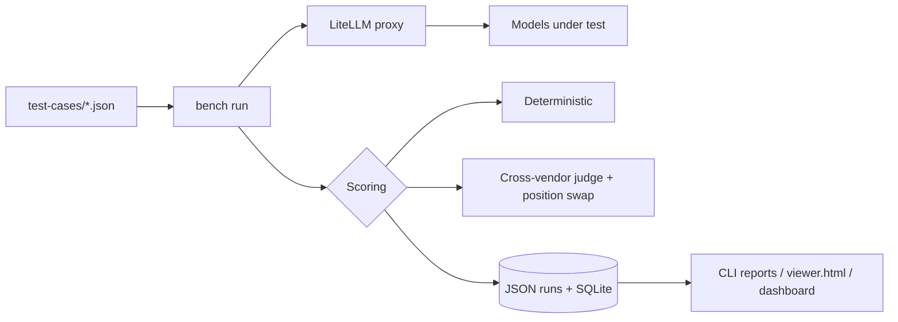

# RodaddyBench

A personal benchmark suite that runs my own work tasks through many LLMs and
scores the answers, so I can pick the right model for each job.

> Portfolio piece. Source shown for review only; not licensed for use. See LICENSE.

## What it does

- Runs a set of JSON test cases against every model exposed by an
  OpenAI-compatible LiteLLM proxy.
- Scores each answer deterministically where there is a right answer (exact
  match, regex, command validation, structured output, weighted checklists)
  and with an LLM judge where quality is subjective.
- Stores every run (JSON files and SQLite), compares runs, flags regressions,
  and charts per-model trends over time.
- Compares cached and non-cached variants of the same model.
- Shows results in a terminal report, a single-file HTML viewer
  (`viewer.html`) and a Next.js dashboard (`dashboard/`).

## The problem

Public leaderboards test generic tasks. They do not say which model writes the
best code review for my TypeScript, gives the correct Proxmox command, or
drafts a post in a usable tone. Model updates also change behaviour without
notice. A small benchmark built from real task types, re-run whenever a model
changes, answers that directly.

## How it works

The CLI loads and validates test cases with Zod, fans them out to every model
through the LiteLLM proxy (OpenAI SDK), and scores each response with the
method the test case declares. Judge scoring picks a judge from a different
vendor family than the model under test (Claude does not judge Claude), scores
against a weighted per-category rubric, and runs a position-swapped second
pass to detect position bias. Each test case is content-hashed so history
stays comparable when a case changes. Each run is written to `results/runs/`
as JSON and to SQLite, which the dashboard reads.



## Features

- `bench run | compare | history | trends | cache-compare | migrate`
- Six scoring methods behind one discriminated-union test-case schema
- Cross-vendor judge selection and position-swap bias check
- Regression detection between runs with a configurable threshold
- Terminal tables, sparklines and trend charts
- 21 test cases today across three categories: code review, content
  generation, infrastructure commands

## Stack

TypeScript on Bun, OpenAI SDK against LiteLLM, Zod, `bun:sqlite`, chalk,
cli-table3, simple-ascii-chart. Dashboard: Next.js 16, React 19, Tailwind,
Recharts, better-sqlite3.

## Status

Experimental personal tool, used locally. The test set covers three of the
categories planned (agent orchestration, adversarial and reasoning cases are
not written yet). The golden answers in `test-cases/` are reference answers
for scoring, not measured results.

## Screenshots

None in the repository.

## Running it locally (for reviewers)

```sh
bun install
bun test src tests/storage tests/cli tests/core tests/display
LITELLM_BASE_URL=http://<your-host>:4000/v1 LITELLM_API_KEY=... bun run src/cli.ts --help
```

A live run needs your own LiteLLM proxy. `tests/integration/pipeline.test.ts`
calls the proxy and needs the same variables.

## Author

Rico Rojas, rico@rtech-consulting.com, https://rico-rojas.com
