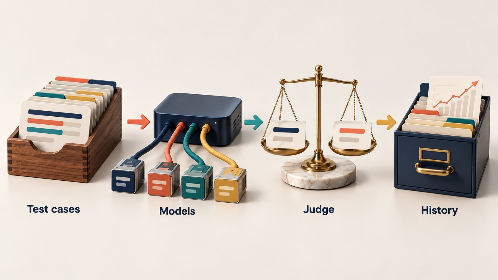
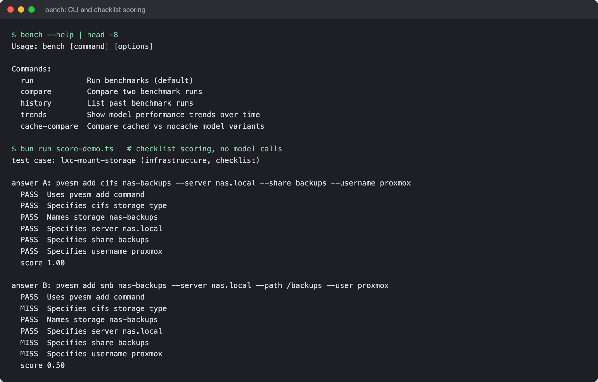

# RodaddyBench

A personal LLM benchmark: real work tasks run through many models and
scored, so each job goes to the model that actually does it best.


## What it is

- Runs a set of JSON test cases against every model exposed by an
  OpenAI-compatible LiteLLM proxy.
- Scores each answer deterministically where there is a right answer
  (exact match, regex, command validation, structured output, weighted
  checklists) and with an LLM judge where quality is subjective.
- Stores every run (JSON files and SQLite), compares runs, flags
  regressions, and charts per-model trends over time.
- Compares cached and non-cached variants of the same model.
- Shows results in a terminal report, a single-file HTML viewer
  (`viewer.html`) and a Next.js dashboard (`dashboard/`).

## Why it exists

Public leaderboards test generic tasks. They do not say which model writes
the best code review for a given TypeScript codebase, gives the correct
Proxmox command, or drafts a post in a usable tone. Model updates also
change behaviour without notice. A small benchmark built from real task
types, re-run whenever a model changes, answers that directly.

## How it works



The CLI loads and validates test cases with Zod, fans them out to every
model through the LiteLLM proxy (OpenAI SDK), and scores each response with
the method the test case declares. Model aliases are resolved to their real
vendor through the proxy's model info, and router aliases are excluded.
Judge scoring picks a judge from a different vendor family than the model
under test (Claude does not judge Claude), scores 1-10 against a weighted
per-category rubric with a conciseness criterion, and runs a
position-swapped second pass to flag position bias. Each test case is
content-hashed so history stays comparable when a case changes. Each run is
written to `results/runs/` as JSON and to SQLite, which the dashboard reads.

The CLI, and the checklist scorer on one of the infrastructure test cases
(the two answers are hand-written samples; the PASS/MISS lines and scores
are the real output of `scoreChecklistDetailed`, no model is called):



## Features

- `bench run | compare | history | trends | cache-compare | migrate`
- Six scoring methods behind one discriminated-union test-case schema
- Cross-vendor judge selection with alias resolution, and a position-swap
  bias check
- Checklist partial credit (3 of 5 items is 0.6, not 0)
- Regression detection between runs with a configurable threshold
- Terminal tables, sparklines and trend charts; an HTML viewer with
  per-criterion breakdowns, a radar chart and bias flags
- Dashboard: leaderboard, run detail, per-model trends, run comparison and
  cost against quality
- 21 test cases across three categories: code review, content generation,
  infrastructure commands

## Stack

TypeScript on Bun, OpenAI SDK against LiteLLM, Zod, `bun:sqlite`, chalk,
cli-table3, simple-ascii-chart. Dashboard: Next.js 16, React 19, Tailwind,
Recharts, better-sqlite3.

## Run it locally (for review)

```sh
bun install
bun test src tests/storage tests/cli tests/core tests/display   # 109 tests, offline
LITELLM_BASE_URL=http://<your-host>:4000/v1 LITELLM_API_KEY=... bun run src/cli.ts --help
```

A live run needs your own LiteLLM proxy. `tests/integration/pipeline.test.ts`
calls the proxy and needs the same variables. The dashboard is in
`dashboard/` (`bun install && bun run dev`, port 3333).

Free for personal and non-commercial use with credit; commercial use needs
a licence. See [LICENSE](LICENSE) (PolyForm Noncommercial 1.0.0).

## Project status

Experimental personal tool, run locally. The test set covers three of the
planned categories (agent orchestration, adversarial and reasoning cases
are not written yet). The golden answers in `test-cases/` are reference
answers for scoring, including some invented example figures inside sample
posts; they are not measured results. No benchmark results are published
in this repository.

## How it was built

Built in two days (2026-02-23 and 2026-02-24, 119 commits) as two planned
milestones: a v1.0 MVP in four phases, then a v1.1 scoring overhaul after
the first results turned out not to mean much. Claude wrote the code; a
separate QA agent, an adversarial reviewer agent and a Gemini code review
checked it. The full story is in [docs/BUILD-STORY.md](docs/BUILD-STORY.md).

## Credits

- [LiteLLM](https://github.com/BerriAI/litellm), the proxy every model call
  goes through.
- Position swapping and verbosity control follow published LLM-as-judge
  practice for reducing position and length bias.

## Author

Rico Rojas, https://rico-rojas.com
